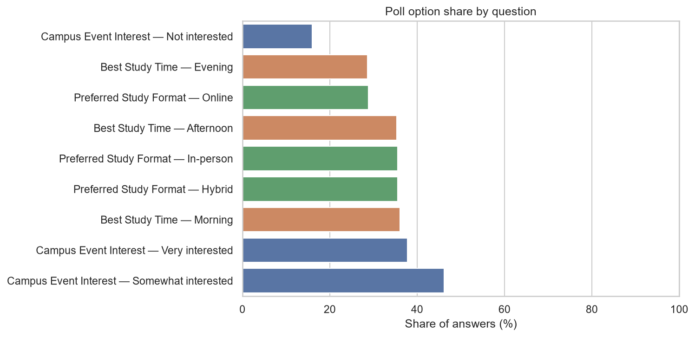
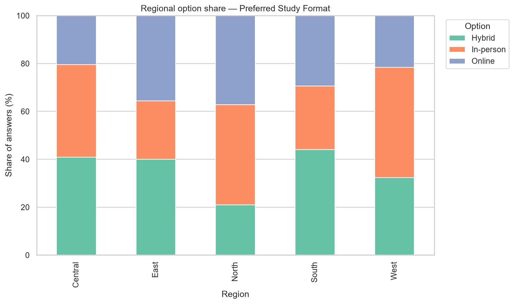
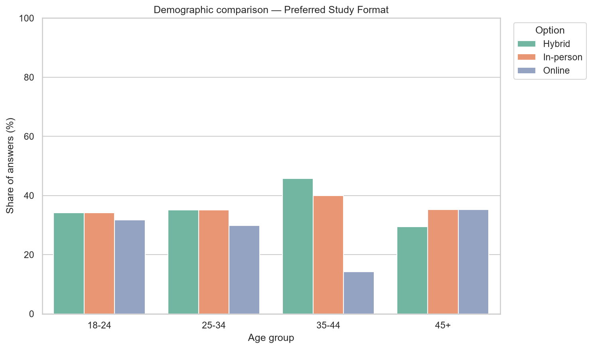
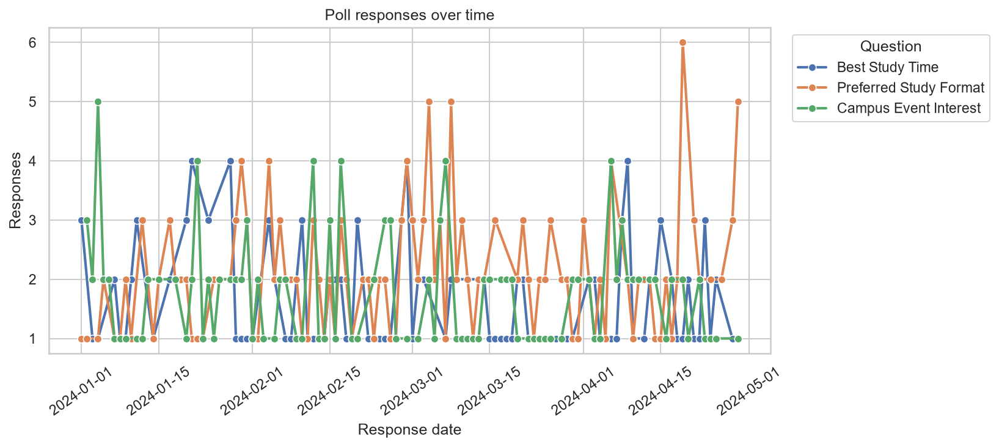

# Poll Results Visualizer

[](#quick-start)
[](#architecture-and-data-flow)
[](#dashboard)
[](#testing-and-verification)

Poll Results Visualizer is a student-built Python project that turns poll or
survey-style CSV rows into cleaned summaries, percentage comparisons, static
charts, a Markdown report, and an interactive Streamlit dashboard. It is
designed as a reproducible portfolio example: the bundled data generator is
deterministic, the analysis rules are tested, and the same pipeline can accept
a sanitized CSV export.

## Contents

- [Demo and screenshots](#demo-and-screenshots)
- [Key features](#key-features)
- [Synthetic sample results](#synthetic-sample-results)
- [Architecture and data flow](#architecture-and-data-flow)
- [Repository structure](#repository-structure)
- [Quick start](#quick-start)
- [Commands](#commands)
- [Custom CSV schema and aliases](#custom-csv-schema-and-aliases)
- [Dashboard](#dashboard)
- [Testing and verification](#testing-and-verification)
- [Data quality and responsible use](#data-quality-and-responsible-use)
- [Upload to GitHub](#upload-to-github)
- [Suggested commit sequence](#suggested-commit-sequence)
- [Interview-ready pitch](#interview-ready-pitch)
- [Roadmap](#roadmap)
- [Contributing](#contributing)
- [Changelog](CHANGELOG.md)
- [License](#license)

## Demo and screenshots

The repository already contains five generated PNG charts. They are static
artifacts from the local pipeline, not live application screenshots.

| Option shares | Regional comparison |
| --- | --- |
|  |  |

| Demographic comparison | Responses over time |
| --- | --- |
|  |  |

Other generated evidence: [overall response pie chart](images/overall_pie.png),
[option-share bar chart](images/option_share_bar.png),
[regional stacked bar](images/regional_stacked_bar.png),
[demographic comparison](images/demographic_comparison.png), and
[date trend](images/date_trend.png).

### Dashboard screenshot placeholders

Run the dashboard locally, capture the states that best tell the project story,
and save them under `images/screenshots/` before publishing. These captures are
optional because the batch charts above are already included:

- `images/screenshots/dashboard-overview.png` — overview with KPI cards and charts.
- `images/screenshots/dashboard-filtered-question.png` — one question with a subgroup filter.
- `images/screenshots/dashboard-download.png` — filtered table and CSV download control.

## Key features

- **Deterministic synthetic data:** generate a chosen number of response rows
  with a repeatable NumPy seed, three questions, subgroup patterns, dates, and
  an optional 1–10 satisfaction score.
- **CSV input:** load a sanitized poll export from
  `data/raw_poll_responses.csv` or pass another path to the CLI.
- **Data cleaning:** normalize column names, trim text, parse dates, remove
  unusable rows and duplicate respondent/question pairs, fill missing optional
  demographics with `Unknown`, and coerce satisfaction values to numeric.
- **Reusable analysis:** calculate option shares, regional shares, demographic
  comparisons, date trends, and short descriptive insight statements.
- **Static evidence:** save four analysis CSVs, a Markdown report, and five
  headless PNG charts using Matplotlib and Seaborn.
- **Interactive dashboard:** explore question, region, age-group, and gender
  filters with Streamlit and Plotly, inspect summary tables, read generated
  insights, and download the filtered rows as CSV.
- **Behavior-focused tests:** check deterministic generation, cleaning rules,
  percentage totals, insight output, and dashboard-facing analysis wrappers.

## Synthetic sample results

> **Synthetic example — 2,000 rows, seed `42`.** The values below are from the
> verified local run represented by `outputs/poll_report.md`. They demonstrate
> reproducibility only; they are not election estimates, customer opinions, or
> evidence about a real population.

| Measure | Recorded result |
| --- | --- |
| Cleaned responses | **2,000** across **3** questions |
| Preferred Study Format | **In-person:** 312 votes (**37.3%**) |
| Campus Event Interest | **Somewhat interested:** 260 votes (**45.1%**) |
| Best Study Time | **Afternoon:** 213 votes (**36.3%**) |
| Largest regional contrast reported | Afternoon was **43.4%** in East, **15.0 percentage points** above South |
| Satisfaction summary | Average **6.4/10**; median **6.4/10** |
| Busiest response date | **2024-04-17**, with **26** responses |

To reproduce the fallback sample in a fresh checkout, run
`python main.py --rows 2000 --seed 42` while
`data/raw_poll_responses.csv` is unavailable. If a valid input CSV already
exists at the default path, the CLI analyzes that file instead. The generated
report is ignored by Git, so the headline results are copied here for a
portable portfolio summary.

## Architecture and data flow

The project keeps the command-line pipeline, analysis functions, chart builders,
and dashboard UI in separate modules so the same business rules are reused.

```text
CSV input --------------------+
                              |
missing/invalid input --------+--> generate_poll_data(rows, seed)
                              |
                              v
                    load_poll_data / clean_poll_data
                              |
                              v
              analyze_option_shares / analyze_region_shares
              analyze_demographics / analyze_time_trends
                              |
                 +------------+-------------+
                 |                          |
                 v                          v
       create_all_visualizations     generate_insights
          five PNG charts           Markdown report
                 |                          |
                 +------------+-------------+
                              v
                 outputs/*.csv, outputs/*.md,
                 images/*.png, or Streamlit UI
```

| Layer | Code | Responsibility |
| --- | --- | --- |
| Input and generation | `main.py`, `src/data_generator.py` | Read a CSV or create a repeatable sample; save the fallback input when needed. |
| Cleaning and validation | `src/analyzer.py` | Normalize fields, validate required columns, parse dates, remove duplicates, and handle missing values. |
| Aggregation | `src/analyzer.py` | Produce option, region, demographic, and date-trend summaries with within-group percentages. |
| Static visualization | `src/visualizer.py` | Save five PNGs with Matplotlib/Seaborn's headless `Agg` backend. |
| Report writing | `main.py` | Write the four analysis CSVs and `poll_report.md`. |
| Interactive view | `dashboard.py` | Reuse the analyzer wrappers for filters, Plotly charts, tables, insights, and CSV download. |
| Verification | `tests/test_pipeline.py` | Protect the most important data and percentage rules. |

### Percentage denominators

The denominator is kept specific to the comparison being shown:

- option analysis: total valid votes for the same question;
- regional analysis: total valid votes for the same region and question;
- demographic analysis: total valid votes for the same group and question; and
- trend analysis: total valid votes for the same date and question.

That design lets subgroup shares add to approximately 100% without comparing a
small group against an unrelated global total.

## Repository structure

```text
.
├── dashboard.py                 # Streamlit application
├── main.py                      # CLI pipeline entry point
├── requirements.txt             # Runtime and test dependencies
├── CHANGELOG.md                 # Human-readable release notes
├── CONTRIBUTING.md              # Contribution and PR guidance
├── LICENSE                      # MIT license; replace the name placeholder
├── .github/workflows/ci.yml     # Tests and smoke checks on GitHub
├── src/
│   ├── __init__.py
│   ├── analyzer.py              # Cleaning, summaries, insights
│   ├── data_generator.py        # Deterministic synthetic responses
│   └── visualizer.py            # Five static PNG charts
├── tests/
│   ├── conftest.py
│   └── test_pipeline.py         # Behavior-focused tests
├── data/
│   ├── README.md
│   ├── .gitkeep
│   └── raw_poll_responses.csv   # Optional/generated input; ignored by Git
├── images/
│   ├── README.md
│   ├── .gitkeep
│   ├── *.png                    # Curated charts shown in this README
│   └── screenshots/             # Optional dashboard/evidence captures
├── outputs/
│   ├── README.md
│   ├── .gitkeep
│   └── *.csv, *.md                 # Generated; ignored by Git
├── notebooks/
│   ├── README.md
│   └── .gitkeep                  # Optional exploratory work
├── .gitignore
└── README.md
```

Generated raw data and analysis tables are ignored by the included `.gitignore`.
The deterministic chart PNGs in `images/` are intentionally tracked because
they make the GitHub README useful immediately; add only curated, non-sensitive
dashboard screenshots to `images/screenshots/`.

## Quick start

### Prerequisites

- Python **3.10 or newer**; Python 3.11 is a good default.
- A terminal opened at the repository root.
- Git is optional for local analysis and required only for the upload steps.

### Windows PowerShell

```powershell
py -m venv .venv
.\.venv\Scripts\Activate.ps1
python -m pip install --upgrade pip
python -m pip install -r requirements.txt
python main.py
```

If PowerShell blocks script activation, use Command Prompt instead:

```bat
py -m venv .venv
.venv\Scripts\activate.bat
python -m pip install -r requirements.txt
python main.py
```

### macOS or Linux

```bash
python3 -m venv .venv
source .venv/bin/activate
python -m pip install --upgrade pip
python -m pip install -r requirements.txt
python main.py
```

The default run reads `data/raw_poll_responses.csv` when it is present and
usable. Otherwise, it creates a deterministic 500-row fallback using seed 42,
then writes the generated input, summaries, report, and charts to the default
`data/`, `outputs/`, and `images/` folders.

## Commands

Run commands from the repository root with the virtual environment activated.

| Command | Purpose |
| --- | --- |
| `python main.py` | Analyze the default CSV, or generate a 500-row fallback when the input is missing/invalid. |
| `python main.py --rows 2000 --seed 42` | Generate the documented synthetic sample when the default input is unavailable. |
| `python main.py --input data/my_poll.csv` | Analyze a custom CSV path. |
| `python main.py --rows 1500 --seed 7 --output-dir outputs/demo_run --image-dir images/demo_run` | Write a run to custom output and image folders. |
| `python main.py --help` | Show all available CLI arguments. |
| `pytest -q` | Run the behavior-focused test suite. |
| `streamlit run dashboard.py` | Start the local interactive dashboard. |
| `deactivate` | Leave the virtual environment. |

The batch pipeline writes:

```text
outputs/option_analysis.csv
outputs/region_analysis.csv
outputs/demographic_analysis.csv
outputs/time_trend_analysis.csv
outputs/poll_report.md
images/option_share_bar.png
images/overall_pie.png
images/regional_stacked_bar.png
images/demographic_comparison.png
images/date_trend.png
```

## Custom CSV schema and aliases

The analyzer expects one response-to-one-question row. These are the canonical
column names:

| Canonical column | Required? | Meaning | Example |
| --- | --- | --- | --- |
| `response_id` | Yes | Respondent or response identifier | `R000001` |
| `response_date` | Yes | Date or timestamp of the response | `2024-01-28` |
| `question` | Yes | Poll question label | `Preferred Study Format` |
| `option` | Yes | Selected answer | `Hybrid` |
| `region` | Yes | Geography or business region | `West` |
| `age_group` | Yes | Age band or cohort label | `18-24` |
| `gender` | Yes | Demographic field; missing values become `Unknown` | `Female` |
| `satisfaction_score` | No | Numeric rating, treated as a 1–10-style score | `7.4` |

Minimal canonical example:

```csv
response_id,response_date,question,option,region,age_group,gender,satisfaction_score
R001,2024-01-01,Preferred Study Format,Hybrid,West,18-24,Female,7
R002,2024-01-02,Preferred Study Format,Online,East,25-34,Male,6
R003,2024-01-03,Preferred Study Format,In-person,North,18-24,Female,8
```

Common aliases are normalized to the canonical names:

| Canonical field | Accepted aliases in the loader |
| --- | --- |
| `response_id` | `id`; labels such as `Response ID` normalize directly to `response_id` |
| `response_date` | `date`, `responded_at`, `Response Date` |
| `question` | `question_text` |
| `option` | `answer`, `choice` |
| `region` | `area`, `location` |
| `age_group` | `age`, `agegroup` |
| `gender` | `sex` |
| `satisfaction_score` | `satisfaction`, `satisfaction_rating` |

Column labels are lowercased, trimmed, and converted from spaces/punctuation to
snake_case before aliases are applied. Extra columns are retained after the
documented fields. When a valid option map is supplied, question and option
labels can also be canonicalized and unknown pairs removed; the generated
fallback uses the built-in map.

### Cleaning behavior

- Blank `response_id`, date, question, or option values are removed.
- Invalid dates are coerced and removed.
- Text is trimmed and repeated whitespace is collapsed.
- Duplicate `response_id` + `question` pairs keep the first row.
- Missing `region`, `age_group`, or `gender` values become `Unknown`.
- `satisfaction_score` is coerced to numeric; missing values use the median when
  at least one numeric value is available.
- A custom CSV must contain all seven required columns, even if some values are
  missing. The cleaning step handles missing values, not missing schema fields.

## Dashboard

Start the local dashboard after installing `streamlit` and `plotly` from
`requirements.txt`:

```bash
streamlit run dashboard.py
```

The app reads `data/raw_poll_responses.csv`. If that file is absent or cannot
be read, it displays a deterministic 2,000-row synthetic sample with seed 42.
Use the sidebar to:

1. choose **All questions** or one question;
2. include or clear **Region**, **Age group**, and **Gender** multiselects;
3. review response, question, leading-option, and region KPI cards;
4. inspect option, regional, demographic, and trend charts;
5. read generated descriptive insights;
6. switch between the four summary-table tabs; and
7. download the currently filtered response rows as `filtered_poll_responses.csv`.

The dashboard delegates cleaning and aggregation to `src/analyzer.py`. Plotly is
used for interactive charts; if Plotly is unavailable, the chart area falls
back to the corresponding summary table while the dashboard remains readable.

## Testing and verification

Run the local suite with:

```bash
pytest -q
```

The tests cover:

- same-seed generation producing the same documented fields and rows;
- duplicate removal, whitespace cleanup, missing-value handling, and numeric
  satisfaction conversion;
- option shares summing to 100% within each question;
- non-empty, readable insight generation; and
- dashboard-friendly wrappers matching the core analysis behavior.

For a manual smoke check, run `python main.py --rows 2000 --seed 42` in a
fresh checkout, confirm four CSV tables, one Markdown report, and five PNGs are
created, then run `streamlit run dashboard.py` and change at least one sidebar
filter. GitHub Actions is configured in `.github/workflows/ci.yml`; it runs the
tests, Python compilation checks, and a temporary-directory pipeline smoke test
on Python 3.10, 3.11, and 3.12 for pushes and pull requests.

## Data quality and responsible use

This is an educational analytics pipeline. The generated data intentionally
contains regional and demographic patterns plus a small amount of missingness so
cleaning and comparison logic can be demonstrated. It is not sampled from a
real population, and the synthetic satisfaction score is not a validated
survey instrument.

For real responses:

- document the source, sampling frame, recruitment method, and response period;
- report row counts, missingness, and subgroup sizes beside important findings;
- inspect duplicates and invalid categories before publishing a chart;
- avoid causal language when the pipeline only shows descriptive association;
- flag or suppress very small groups before sharing comparisons;
- remove direct identifiers and do not commit private responses or secrets; and
- add uncertainty methods when the decision requires more than descriptive
  percentages.

The project can show a pattern in the supplied rows. It cannot establish that
the pattern generalizes to a wider population or explain why it occurred.


### 30-second version

> I built Poll Results Visualizer in Python to turn response-level poll data
> into cleaned summaries, subgroup comparisons, charts, and short insights. I
> used deterministic synthetic data because private survey data was not
> available, but the schema and alias-aware loader accept a sanitized CSV
> export. The project includes a tested batch pipeline, five static charts, a
> Markdown report, and a Streamlit dashboard, so it demonstrates both analysis
> and stakeholder-friendly communication.

### Technical follow-up

The pipeline separates generation, cleaning, analysis, visualization, and UI.
`analyzer.py` uses grouped counts with question- or subgroup-specific
denominators; `visualizer.py` uses Matplotlib's headless backend for reproducible
PNG output; and `dashboard.py` reuses the same analysis wrappers instead of
maintaining a second calculation path. The tests protect deterministic output,
duplicate handling, missing-value rules, and percentage totals.

## Roadmap

Planned improvements, not current capabilities:

- add a visible rejected-row/data-quality report with reasons;
- add minimum-sample warnings and confidence intervals for real survey use;
- add more public or form-export input examples and an optional notebook story;
- add reviewed open-text/sentiment analysis for a future response field;
- add a privacy-aware export mode for small subgroups;
- add dashboard deployment only after data handling and privacy review; and
- add linting and coverage thresholds if the project grows beyond this portfolio
  baseline.

## Contributing

Suggestions and small improvements are welcome through GitHub issues and pull
requests. The detailed contributor guide is in
[`CONTRIBUTING.md`](CONTRIBUTING.md). Before opening a change:

1. keep the core pipeline reproducible;
2. run `pytest -q`;
3. update the README when commands or outputs change; and
4. never include private responses, credentials, or generated secrets.

For GitHub's general workflow, see the
[official pull request documentation](https://docs.github.com/en/pull-requests).

## License

This project is distributed under the [MIT License](LICENSE). Before publishing,
replace `<YOUR NAME>` in `LICENSE` with the copyright holder's name and confirm
that the license is compatible with any external dataset or code you add.

## Author
**Jayesh Rathi** — 3rd Year IT Student, Government College of Engineering, Amravati  
[LinkedIn](https://www.linkedin.com/in/jayesh-rathi-5ab8973b6) | [Email](mailto:jayeshrathinew@gmail.com)
